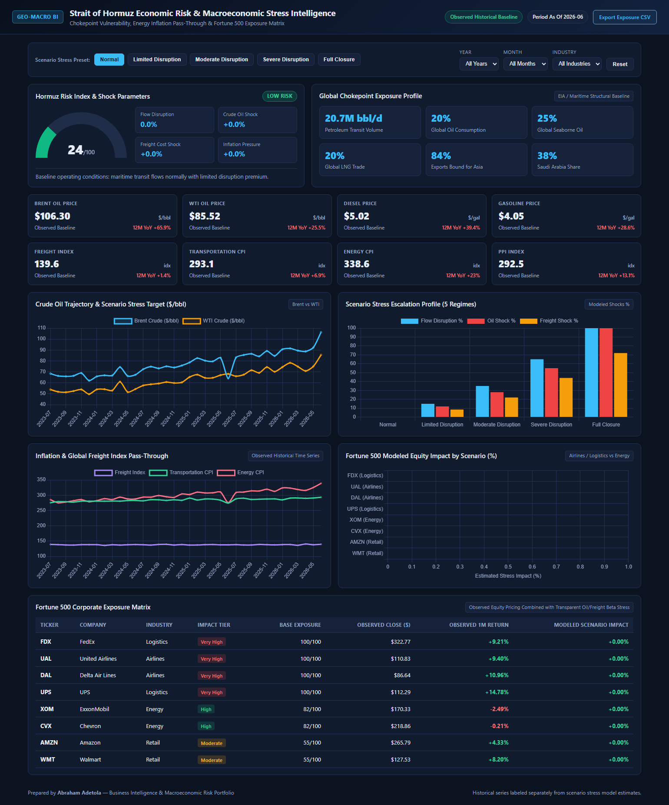
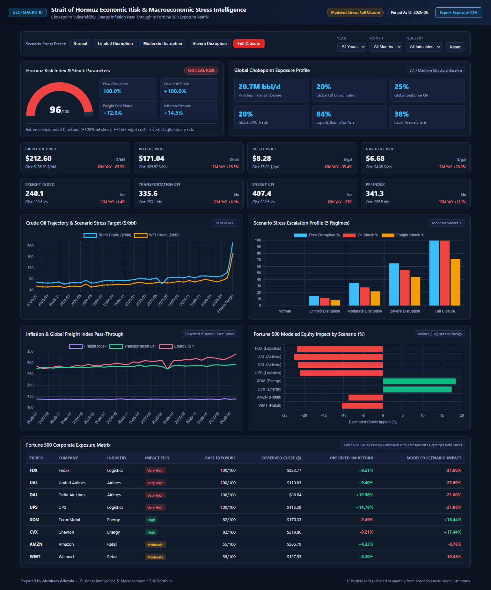

# Strait of Hormuz Economic Risk & Macroeconomic Stress Intelligence

> Enterprise geopolitical chokepoint intelligence platform quantifying maritime disruption regimes, macroeconomic energy-inflation pass-through, and Fortune 500 corporate beta sensitivity — with strict governance separating **Observed Historical Baselines** from **Modeled Scenario Stress Estimates**.

**Author:** Abraham Adetola (`abrahamnewwine@gmail.com`) | Atlanta, Georgia, USA  
**Domain:** Geopolitical Risk Intelligence · Macroeconomic BI · Scenario Stress Testing · Business Analysis  

---

## Live Dashboard Previews

### Baseline View — Observed Historical Macro & Normal Chokepoint Regime (`Risk Index: 24`)


### Stress Simulation — Full Closure Regime (`Risk Index: 96 / CRITICAL RISK`)


---

## 1. Business Problem & Objectives
Roughly **20.7 million barrels per day** (~20% of global oil consumption, ~25% of seaborne crude trade, and ~20% of global LNG trade) transits the Strait of Hormuz, with **84%** of crude bound for Asian refineries. Corporate treasury, airline, logistics, and equity risk teams need an interactive analytical cockpit that connects **real historical macroeconomic series and market equity quotes** to transparent scenario stress parameters.

### Core Objectives
- Combine 138 monthly observations across **8 macro indicators** (Brent, WTI, US Diesel, US Gasoline, Global Freight Index, Transportation CPI, Energy CPI, and PPI) with live-refreshable Fortune 500 equity pricing across **Airlines (`DAL`, `UAL`)**, **Logistics (`UPS`, `FDX`)**, **Retail (`WMT`, `AMZN`)**, and **Energy (`CVX`, `XOM`)**.
- Implement 5 pre-calibrated scenario stress presets (`Normal` → `Limited Disruption` → `Moderate Disruption` → `Severe Disruption` → `Full Closure`) driving a 0–100 **Hormuz Risk Index Gauge**.
- Prevent analytical misinterpretation by labeling every stressed card and table figure as a **Modeled Stress Estimate** alongside its underlying **Observed Historical Baseline**.

---

## 2. Architecture & Technology Stack
- **Backend & REST API:** Python 3.13, FastAPI, Uvicorn, Pydantic/query validation (`HTTP 400` on unknown scenario)
- **Data Warehouse & SQL:** SQLite star schema (`dim_date`, `dim_company`, `dim_scenario`, `fact_macro_monthly`, `fact_corporate_exposure`) + CSV exports
- **Analytics & Data Sources:** Verified multi-year macro snapshot (`data/raw/hormuz_macro_monthly.csv`) and Yahoo Finance public chart API equity quotes (`data/raw/fortune500_snapshot.csv`, optional `--refresh` live update with offline fallback)
- **Visualization & BI:** Interactive Chart.js 4.4.7 frontend + Power BI Semantic Layer ([`data_model.md`](powerbi/data_model.md), [`measures.dax`](powerbi/measures.dax), [`power_query.m`](powerbi/power_query.m))
- **BA Artifact Suite:** Complete 8-document markdown BA suite + Excel workbooks (`rtm_workbook.xlsx`, `uat_test_log.xlsx`) + ReportLab PDF (`executive_insights_report.pdf`)

---

## 3. Verified Baseline & Scenario Outputs
*Observed macro baseline cutoff: `2026-06`; Equity quotes fetched live from Yahoo Finance public chart endpoint.*

| Indicator | Observed Baseline | 12M Obs YoY | Full Closure Modeled (`Risk 96`) |
|-----------|-------------------|-------------|----------------------------------|
| Brent Crude Oil (`$/bbl`) | `$106.30` | `+65.9%` | `$212.60` |
| WTI Crude Oil (`$/bbl`) | `$85.52` | `+25.5%` | `$171.04` |
| Diesel (`$/gal`) | `$5.02` | `+39.4%` | `$8.28` |
| Gasoline (`$/gal`) | `$4.05` | `+28.6%` | `$6.68` |
| Freight Index | `139.6` | `+1.4%` | `240.1` |
| Transportation CPI | `293.08` | `+6.9%` | `335.58` |
| Energy CPI | `338.64` | `+23.0%` | `407.38` |
| PPI Index | `292.5` | `+13.1%` | `341.27` |

**Modeled Fortune 500 Impact (`Full Closure` Regime):**  
- **High Headwind (Airlines / Logistics):** `UAL (-22.60%)`, `FDX (-21.80%)`, `DAL (-21.60%)`, `UPS (-21.08%)`  
- **Moderate Freight Compression (Retail):** `WMT (-10.48%)`, `AMZN (-8.76%)`  
- **Energy Upstream Hedge:** `XOM (+18.44%)`, `CVX (+17.44%)`

---

## 4. Repository Structure
```text
├── app/                      # FastAPI application, HTML template, CSS, Chart.js frontend
├── assets/screenshots/       # Captured Playwright cockpit screenshots (Normal & Full Closure)
├── data/
│   ├── raw/                  # hormuz_macro_monthly.csv & fortune500_snapshot.csv
│   └── processed/            # Exported star-schema CSVs (SQLite DB generated at runtime)
├── docs/business-analysis/   # Business Case, BRD, RACI, Gap Analysis, RTM (.xlsx/.md), UAT (.xlsx/.md), PDF Report
├── powerbi/                  # Star schema documentation, DAX measures, Power Query M
├── sql/                      # SQLite DDL schema & analytical stress queries
├── src/                      # Config, ETL pipeline, stress-testing analytics engine, BA workbook/PDF generator
├── tests/                    # Automated pytest verification suite
└── run.py                    # Single-command runner (--refresh, --ba-only)
```

---

## 5. Quickstart & Testing
```bash
pip install -r requirements.txt
python run.py                # Starts dashboard on http://127.0.0.1:8004
python run.py --refresh      # Refreshes live Yahoo Fortune 500 quotes before launch
python run.py --ba-only      # Builds DB + generates Excel RTM, Excel UAT Log, PDF Report
pytest -v                    # Executes automated pipeline, stress math, API, and artifact tests
```

## 6. Video Demonstration
Video Demonstration: Coming Soon.

---

## License & Author
Portfolio Project by **Abraham Adetola** — Business Intelligence & Business Analyst Professional (`abrahamnewwine@gmail.com`).
