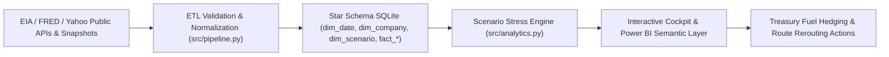

# Process Mapping & Gap Analysis — Project 4

**Document ID:** GAP-P4-004  
**Author:** Abraham Adetola  

## As-Is Process vs. To-Be Target State

| Dimension | As-Is State | To-Be Target State | Gap Closure Mechanism |
|-----------|-------------|--------------------|-----------------------|
| Macro Tracking | Ad-hoc EIA/FRED spreadsheet lookups | Unified 8-indicator monthly baseline with 12M YoY telemetry | Automated SQLite pipeline + normalized date dimension |
| Scenario Analysis | Static slide assumptions during crisis events | Interactive 5-regime stress toggle with Risk Index gauge | Pre-calibrated `dim_scenario` + transparent multiplier model |
| Data Provenance | Risk of confusing forecast estimates with historical actuals | Hard visual/JSON split (`observed_value` vs `modeled_value`) | Dual-field API schema + badge switch in UI |
| Corporate Exposure | Qualitative intuition on oil impact per sector | Quantitative exposure score (`base_exposure_score`) + signed beta shock | `dim_company` oil/freight sensitivity coefficients |
